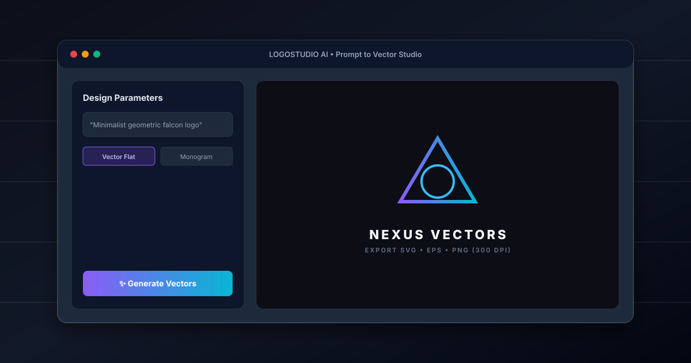

<div align="center">
  

  # 🎨 LOGOSTUDIO-AI
  <p><strong>AI-driven vector branding engine & generative logo customization workspace.</strong></p>

  <p>
    
    
    
    
    
  </p>
</div>

---

## 📌 Overview

**LOGOSTUDIO-AI** bridges high-fidelity UI design and generative AI to create responsive, production-ready brand marks. Instead of raw pixel outputs, this studio produces structured assets customizable across palettes, aspect ratios, and visual weights.

### 🌟 Key Capabilities
- **Iterative AI Prompting:** Transform natural language descriptions into balanced geometric marks.
- **Dynamic Palette Calibration:** Live SVG path recoloring and gradient mapping without quality loss.
- **Export Formats:** Direct high-resolution asset export with customizable paddings and backgrounds.
- **Modular Design System:** Built on top of Radix primitives and styled with Tailwind CSS for accessible interactions.

---

## 🏗️ Architecture & File Structure

```
LOGOSTUDIO-AI/
├── public/                  # Static assets & 3D illustrations
├── src/
│   ├── components/          # Reusable UI primitives (Radix + Tailwind)
│   ├── features/            # Feature-driven slices
│   │   ├── logo-generator/  # Prompt form, preview stage, customization controls
│   │   └── logo-examples/   # Curated preset library
│   ├── lib/                 # Core utilities & API abstraction
│   ├── pages/               # Routed view templates
│   ├── App.tsx              # Application shell & context providers
│   └── main.tsx             # Entrypoint
├── tailwind.config.ts       # Design tokens & layout constraints
└── vite.config.ts           # Build pipeline configuration
```

---

## ⚡ Quick Start

### Prerequisites
- **Node.js**: `v18.x` or higher
- **Package Manager**: `npm`, `pnpm`, or `bun`

### Installation
```bash
# Clone the repository
git clone https://github.com/Shubhamd7744/LOGOSTUDIO-AI.git
cd LOGOSTUDIO-AI

# Install dependencies
npm install

# Start development server
npm run dev
```

Open [http://localhost:5173](http://localhost:5173) in your browser.

---

## 🛡️ Engineering Decisions
1. **Feature-First Architecture:** Keeps domain logic (`features/logo-generator`) decoupled from generic design components (`components/ui`).
2. **Type-Safe Props:** Strict TypeScript interfaces for all logo attributes (geometry, typography hierarchy, SVG paths).
3. **Optimistic Previews:** Instant client-side state manipulation during color and dimension changes.

---

<div align="center">
  <sub>Maintained by <a href="https://github.com/Shubhamd7744">Shubham Dutta</a> • UI/UX Designer & Frontend Developer</sub>
</div>